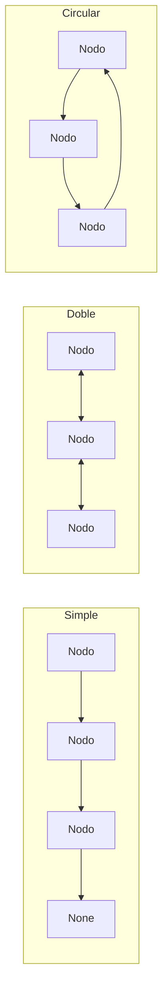

# Registros Académicos · Listas Enlazadas en Python


> Gestión de inscritos, historial académico y grupos de estudio usando listas enlazadas
> simple, doble y circular implementadas desde cero, con persistencia en CSV y JSON.

## Descripción

Proyecto de estructuras de datos en Python que implementa tres tipos de listas enlazadas **sin usar `list` para almacenar nodos**, aplicadas a tres registros académicos:

| Módulo | Estructura | Contenido de cada nodo | Persistencia |
|---|---|---|---|
| 1. Inscritos | **Lista simple** (`ListaSimple`) | `id`, `nombres`, `correo` | **CSV** (`data/inscritos.csv`) |
| 2. Historial | **Lista doble** (`ListaDoble`) | semestre: `anio`, `term`, `materias[{cod,nombre,nota}]` | **JSON** (`data/historial.json`) |
| 3. Grupos | **Lista circular** (`ListaCircular`) | `nombre_grupo`, `tutor`, `tema` | **JSON** (`data/grupos.json`) |

`list`/`dict` se usan **solo** en `to_dict()/from_dict()` y en los archivos de persistencia.
La lista circular incluye búsqueda **recursiva** con traza: `ListaCircular.buscar_recursivo(valor)`.

## Estructuras implementadas



## Instalación

```bash
git clone https://github.com/Abel-Gavilanez/registros-academicos-listas-enlazadas-persistencia.git
cd registros-academicos-listas-enlazadas-persistencia
```

**Requisitos:** Python 3.8 o superior. No necesita librerías externas, solo la biblioteca estándar.

## Cómo ejecutar

Desde la raíz del repositorio:

```bash
python src/app.py                 # menú principal en consola
python src/casos_prueba.py        # casos de demostración (deja datos de ejemplo en data/)
python src/casos_prueba.py --tmp  # igual, pero en una carpeta temporal (no toca data/)
```

## Uso

1. **Lista simple**: menú `1` → agregar 3 inscritos, buscar por id, eliminar 1, mostrar, exportar CSV (`5`), limpiar (`7`), importar (`6`) y volver a mostrar (`4`).
2. **Lista doble**: menú `2` → agregar semestres **desordenados** (p. ej. 2024-1, 2023-2, 2025-1) y comprobar el orden con `4`/`5` (adelante/atrás); exportar (`6`) e importar (`7`) JSON.
3. **Lista circular**: menú `3` → agregar 3 grupos, `3` buscar (recursivo, con traza), `4` rotar 2, `5` recorrer 2 vueltas (se ve el ciclo), `2` eliminar uno y volver a recorrer.
4. **Reportes** (menú `4`): Top 3 mejores promedios, siguiente grupo en turno (tras rotar) y cantidad de inscritos.

## Demo

```text
=== MENÚ PRINCIPAL ===
1. Inscritos (lista simple)
2. Historial (lista doble)
3. Grupos (lista circular)
4. Reportes
0. Salir
Opción:
```
   🎥 [Ver video de demostración](PEGA_AQUÍ_TU_ENLACE)

## Pruebas

```bash
python -m unittest discover -s src -v   # 21 pruebas unitarias
```

## Complejidad de operaciones

| Operación | Simple | Doble | Circular |
|---|---|---|---|
| Insertar al final | O(1) (puntero `cola`) | O(1) (puntero `cola`) | O(1) (puntero `cola`) |
| Buscar | O(n) | O(n) | O(n) |
| Eliminar | O(n) | O(n) | O(n) |
| Recorrer | O(n) | O(n) | O(n) |
| Rotar `k` posiciones | n/a | n/a | O(k) |

## Estructura

```text
.
├── src/
│   ├── nodo_simple.py        # NodoSimple   { valor, siguiente }
│   ├── nodo_doble.py         # NodoDoble    { valor, anterior, siguiente }
│   ├── nodo_circular.py      # NodoCircular { valor, siguiente }
│   ├── modelos.py            # Estudiante, RegistroSemestre, Grupo
│   ├── lista_simple.py       # ListaSimple
│   ├── lista_doble.py        # ListaDoble
│   ├── lista_circular.py     # ListaCircular (buscar_recursivo)
│   ├── persistencia_csv.py   # exportar_csv / importar_csv
│   ├── persistencia_json.py  # exportar_json / importar_json
│   ├── app.py                # menú principal
│   ├── casos_prueba.py       # casos de demostración
│   └── test_listas.py        # pruebas unitarias
├── data/                     # inscritos.csv, historial.json, grupos.json
├── .gitignore
└── README.md
```

## Notas de diseño

- Escala de notas 0–10, definida en la constante `NOTA_MAX` de `modelos.py`; puede modificarse para otra escala.
- `ListaSimple`, `ListaDoble` y `ListaCircular` mantienen un puntero `cola` para enlazar al final en O(1).
- Las escrituras de archivos son atómicas (archivo temporal + `os.replace`).
- El JSON incluye el campo `"tipo"` para reconstruir la lista correcta; el de grupos guarda además el turno `actual`.
- `rotar(k)` es O(k); si se conserva el puntero `actual`, cada avance cuesta O(1).

## Licencia

Distribuido bajo la licencia MIT. Consulta el archivo `LICENSE` para más información.
